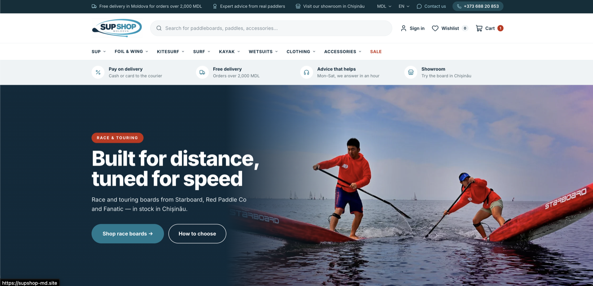
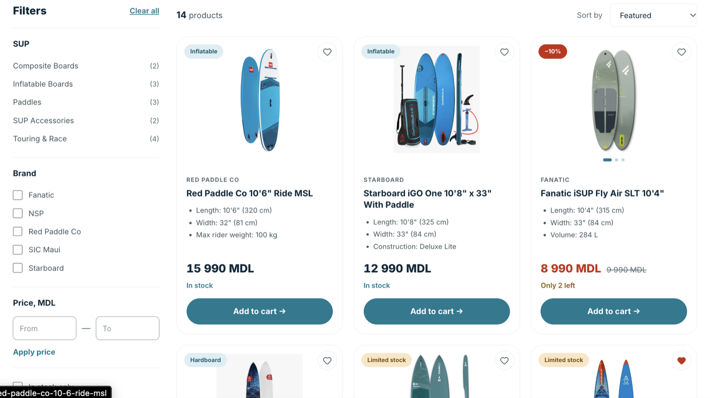
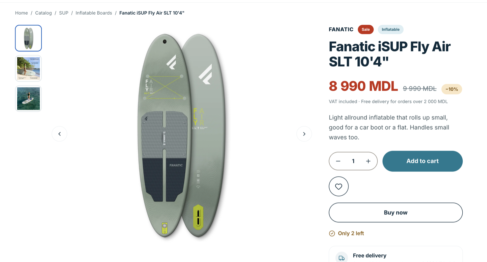
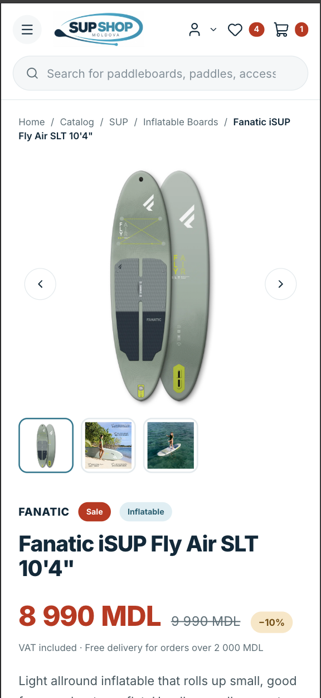
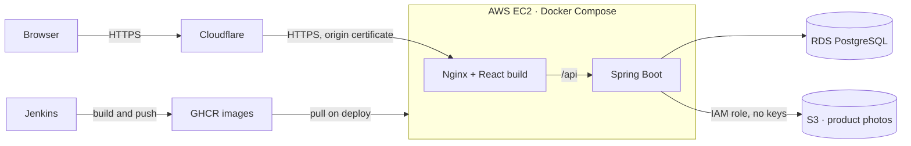

# SUP Shop Moldova — Backend

Online store for stand up paddle boards and water sports gear for the Moldovan market.
Full-stack portfolio project: Spring Boot REST API + React SPA, deployed on AWS with a Jenkins CI/CD pipeline.

**Live:** https://supshop-md.site · **Frontend:** [sup-shop-frontend](https://github.com/denis-buimistr/sup-shop-frontend)



| Catalog | Product page | Mobile |
|---|---|---|
|  |  |  |

## Features

- **Catalog** — category tree, filters (brand, price, in stock, on sale), sorting, search, pagination, SEO-friendly slugs
- **Cart and checkout** — multi-step checkout, delivery price calculated on the server, order history with statuses
- **Wishlist** — for guests and accounts, guest list is merged on sign-in
- **Three languages** — English, Romanian and Russian: UI texts, product content and API error messages
- **Admin panel** — orders, products with photo upload to S3 and drag-to-reorder, categories, brands, users, translations
- **Accounts** — sign in with email or username, JWT authentication, roles `USER` and `ADMIN`

## Architecture



- The server accepts traffic only from Cloudflare IP ranges, the database has no public address and is reachable only from the server.
- The application accesses S3 through an IAM role attached to EC2, there are no AWS keys on the server.
- Secrets are passed only through environment variables, in production they have no defaults (the app fails fast without them).

## Tech stack

| Layer | Technologies |
|---|---|
| Backend | Java 21, Spring Boot 4.1, Spring Security + JWT (jjwt), Spring Data JPA / Hibernate 7, Bean Validation, Flyway |
| Database | PostgreSQL 16 |
| Frontend | React 19, Vite 8, React Router 7, Tailwind CSS 4, i18next |
| Tests | JUnit 5, Mockito, AssertJ, MockMvc, Testcontainers, Vitest, Testing Library |
| Infrastructure | Docker, Docker Compose, AWS (EC2, RDS, S3, IAM), Cloudflare, Nginx, Jenkins, GitHub Container Registry |

## Project structure

```
src/main/java/.../
  controller/   thin REST controllers, validation of incoming DTOs
  service/      business logic and transactions
  repository/   Spring Data JPA repositories and specifications
  model/        JPA entities
  dto/          request and response records
  security/     JWT filter and user loading
  exception/    domain exceptions and the global error handler
  config/       security, S3, i18n, first admin bootstrap
src/main/resources/
  db/migration/ Flyway migrations: V1 schema, V2 demo catalog
  messages*.properties   API messages in EN / RO / RU
jenkins/        Jenkins image and compose file for CI
```

## API overview

| Area | Endpoints |
|---|---|
| Auth | `POST /api/auth/register`, `POST /api/auth/login` |
| Catalog | `GET /api/products`, `GET /api/products/slug/{slug}`, `GET /api/categories`, `GET /api/brands` |
| Cart | `GET/POST /api/cart/items`, `PUT/DELETE /api/cart/items/{productId}` |
| Orders | `POST /api/orders/checkout`, `GET /api/orders/my`, `PATCH /api/orders/{id}/status` |
| Wishlist | `GET /api/wishlist`, `PUT/DELETE /api/wishlist/{productId}`, `POST /api/wishlist/merge` |
| Profile | `GET/PUT /api/profile`, `POST /api/profile/change-password` |
| Admin | `/api/admin/orders`, `/api/admin/products`, `/api/admin/users`, CRUD for products, categories, brands, photos and translations |

Errors come in one format (`ErrorResponse`) and in the language from the `Accept-Language` header.
Interactive docs: Swagger UI at `/swagger-ui.html` when running locally (disabled in production).

## Tests

74 tests on three levels:

- **Unit** — services with Mockito
- **Web layer** — `@WebMvcTest` with the real security configuration
- **Integration** — the whole application on a real PostgreSQL via Testcontainers: concurrent checkout of the last items in stock, transaction rollback, sign in with email or username

```bash
./mvnw test
```

Docker must be running: integration tests start PostgreSQL in a container.

## Run locally

### Option 1. Everything in Docker

Needs Docker and both repositories cloned next to each other:

```
dev/
  sup-shop-backend/
  sup-shop-frontend/
```

```bash
cp .env.example .env      # fill in passwords, JWT secret and the first admin
docker compose up --build
```

Open http://localhost:3000. On the first start Flyway creates the schema and the demo catalog, and the first admin is created from the `ADMIN_*` variables.

### Option 2. Development mode

```bash
docker run -d --name sup-shop-db -p 5432:5432 \
  -e POSTGRES_DB=sup_shop -e POSTGRES_USER=sup_admin -e POSTGRES_PASSWORD=supsecret postgres:16
./mvnw spring-boot:run    # dev profile, API on http://localhost:8080
```

Then start the frontend with `npm run dev` (see the frontend README). Photo upload needs AWS credentials in `~/.aws/credentials`, everything else works without them.

## CI/CD and deployment

Jenkins runs in Docker (configuration in [`jenkins/`](jenkins)) with a multibranch pipeline for each repository:

1. **Every branch** — tests (JUnit report in Jenkins), Docker image tagged with the commit hash
2. **`main` only** — push the image to GitHub Container Registry as `:hash` and `:latest`
3. **`main` only** — deploy over SSH: `docker compose pull` and `up --wait`, the build fails if the new container does not become healthy

Production runs [`docker-compose.prod.yml`](docker-compose.prod.yml) on EC2: ready images from GHCR, database in RDS, HTTPS with a Cloudflare origin certificate ([`nginx-ssl.conf`](nginx-ssl.conf)).

## Known limitations and next steps

- N+1 queries in the catalog listing — plan: `@EntityGraph` / batch fetching
- Product photos are served in the original size — plan: resized variants on upload
- No password reset and no email notifications yet (needs mail sending)
- Payments are only a choice of method, no real payment provider yet
- Production secrets live in an env file on the server — plan: AWS Parameter Store
